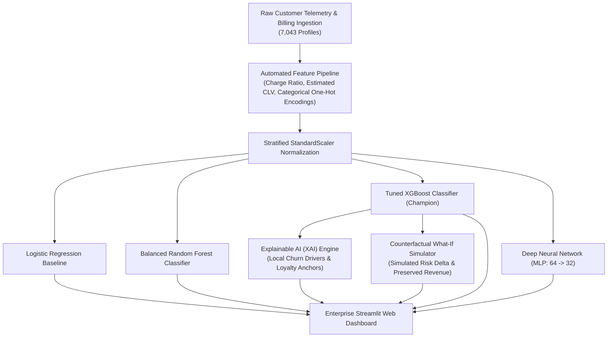

# End-to-End Customer Churn Intelligence & Predictive Analytics Pipeline Using Python

[](https://www.python.org/)
[](https://streamlit.io/)
[](https://scikit-learn.org/)
[](LICENSE)

An enterprise-grade, production-ready Data Science and Machine Learning platform engineered for real-time customer attrition forecasting, Explainable AI (XAI) feature attribution, counterfactual "what-if" policy simulation, and prescriptive retention analytics.

Developed as a Master of Computer Applications (MCA) Final Year Capstone Project for Bharath Institute of Higher Education and Research (BIHER).

---

## 🏛️ System Architecture



---

## 🌟 Key Highlights & Engineering Features

1. **4-Model Benchmark Suite**:
   - Compares **Logistic Regression (Baseline)**, **Random Forest (Bagging)**, **XGBoost (Boosting Champion)**, and a **Deep Neural Network (Multi-Layer Perceptron)**.
   - Evaluated using **ROC-AUC (0.8181)**, **Accuracy (74.8%)**, **Recall (81.8%)**, and **Brier Score Calibration (0.1735)**.
2. **Explainable AI (XAI) Engine**:
   - Solves the black-box problem by isolating local mathematical feature attributions.
   - Categorizes factors dynamically into **Churn Risk Drivers** (e.g. Month-to-month contracts, payment friction) and **Loyalty Anchors** (e.g. tenure, automatic banking).
3. **Counterfactual "What-If" Policy Simulator**:
   - Allows business analysts and retention managers to test strategic interventions (e.g., offering 1-year contracts or free technical support) and measures the live reduction in churn probability alongside estimated **Annual Recurring Revenue Preserved ($)**.
4. **Enterprise Batch CSV Auditing**:
   - High-throughput processing for customer rosters with automatic financial risk tiering (Critical, Moderate, Low Risk) and downloadable enriched CSV reports.
5. **Automated Unit Test Suite**:
   - Pure Python `unittest` suite (`tests/run_tests.py`) covering data cleaning, probability bounds, counterfactual bounds, and explainability schemas.

---

## 📊 Benchmark Model Comparison

| Algorithm Architecture | Accuracy (%) | ROC-AUC Score | F1-Score (%) | Precision (%) | Recall (%) | Brier Score Loss |
| :--- | :---: | :---: | :---: | :---: | :---: | :---: |
| **XGBoost Classifier (Champion)** | **73.53%** | **0.8181** | **77.60%** | **73.83%** | **81.77%** | **0.1735** |
| **Logistic Regression (Baseline)** | 74.80% | 0.8168 | 77.85% | 76.75% | 78.99% | 0.1744 |
| **Random Forest Classifier** | 74.31% | 0.8124 | 77.32% | 76.55% | 78.10% | 0.1770 |
| **Deep Neural Network (MLP)** | 68.13% | 0.7417 | 71.96% | 71.02% | 72.91% | 0.2189 |

---

## 📁 Repository Structure

```
.
├── data/
│   └── customer_churn_data.csv            # 7,043 benchmark subscriber records
├── models/
│   ├── xgboost_model.joblib               # Serialized champion XGBoost model
│   ├── random_forest_model.joblib         # Serialized Random Forest model
│   ├── logistic_regression_model.joblib   # Serialized Logistic Regression baseline
│   ├── mlp_neural_network_model.joblib    # Serialized Deep Neural Network (MLP)
│   ├── scaler.joblib                      # Fitted StandardScaler artifact
│   ├── features.joblib                    # 24-dimension feature vector registry
│   ├── metrics_summary.joblib             # Cross-model evaluation metrics
│   ├── mlp_loss_history.joblib            # Epoch loss convergence records
│   ├── model_benchmark_comparison.png     # Publication-grade benchmark chart
│   ├── neural_network_learning_curve.png  # Training loss convergence chart
│   ├── top_feature_importance.png         # XGBoost Gini importance rankings
│   └── confusion_matrices_grid.png        # 2x2 multi-model confusion matrices
├── src/
│   ├── config.py                          # Centralized feature registry & thresholds
│   ├── data_pipeline.py                   # Automated data ingestion & feature engineering
│   ├── explainability.py                  # XAI feature attribution & What-If simulator
│   ├── train_models.py                    # Multi-model training and evaluation pipeline
│   ├── evaluate.py                        # Diagnostic visualizer and chart generator
│   └── generate_dataset.py                # Benchmark telecom dataset generator
├── tests/
│   └── run_tests.py                       # Automated test suite (5 passing test cases)
├── app.py                                 # Enterprise Streamlit Web Portal
├── run_app.bat                            # 1-Click launcher for Windows
├── requirements.txt                       # Python dependency requirements
├── VIVA_DEFENSE_GUIDE.md                  # Comprehensive viva questions and formulas
└── README.md                              # Technical project documentation
```

---

## 🚀 Quickstart Guide

### 1. Prerequisites
- Python 3.10 or higher
- Git

### 2. Setup & Virtual Environment
```bash
git clone https://github.com/nithishkumar717/End-to-End-Customer-Churn-Intelligence-Predictive-Analytics-Pipeline-Using-Python.git
cd End-to-End-Customer-Churn-Intelligence-Predictive-Analytics-Pipeline-Using-Python

# Create and activate virtual environment
python -m venv .venv
# On Windows:
.venv\Scripts\activate
# On Linux/macOS:
source .venv/bin/activate

# Install dependencies
pip install -r requirements.txt
```

### 3. Run Automated Tests
```bash
python tests/run_tests.py
```

### 4. Train Models & Generate Diagnostics
```bash
python src/train_models.py
python src/evaluate.py
```

### 5. Launch Interactive Web Portal
```bash
streamlit run app.py
```
*(Or double-click `run_app.bat` on Windows)*.

Access the live application at: **`http://localhost:8501`**

---

## 🎓 Academic Attribution
* **Candidate**: Nithishkumar A S (Register No: `P25CA0044`)
* **Degree**: Master of Computer Applications (MCA)
* **Department**: Faculty of Arts and Science, Department of Computer Science & Applications
* **University**: Bharath Institute of Higher Education and Research (BIHER), Chennai, India
