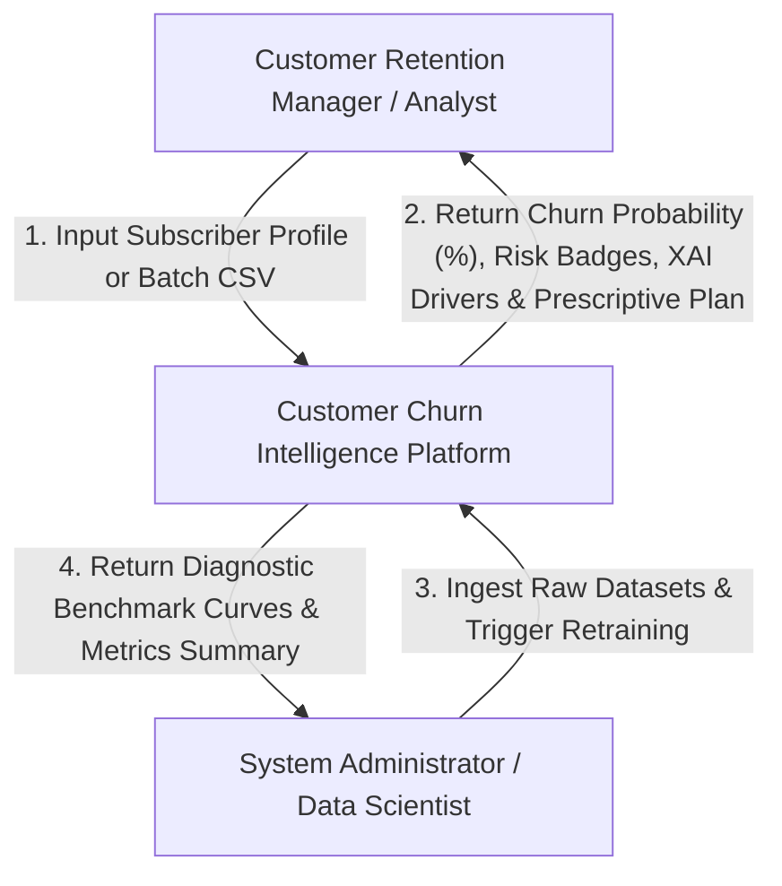
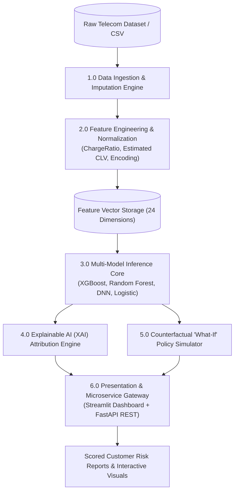
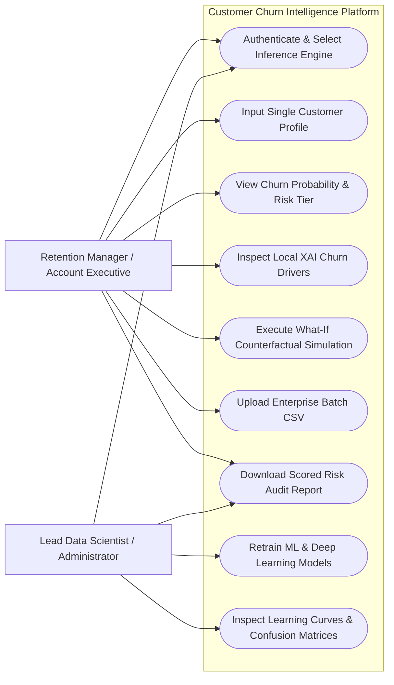
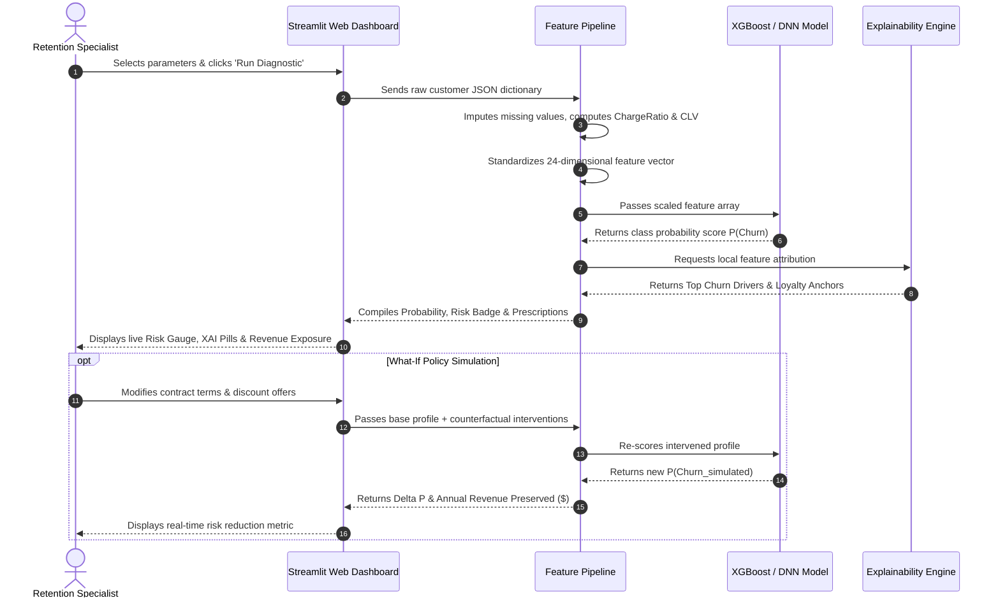
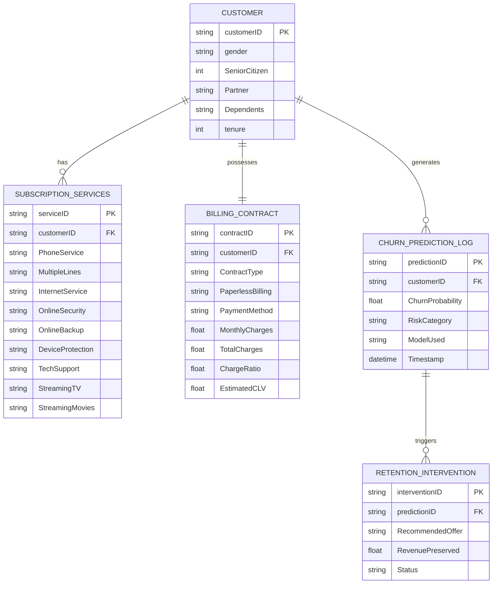

# System Architecture, DFD & UML Design Specifications

**Project:** End-to-End Customer Churn Intelligence & Predictive Analytics Pipeline Using Python  
**Candidate:** Nithishkumar A S (Register Number: P25CA0044)  
**Degree:** Master of Computer Applications (MCA), BIHER

---

## 1. Data Flow Diagrams (DFD)

### 1.1 DFD Level 0 (Context Diagram)

---

### 1.2 DFD Level 1 (Functional Decomposition)

---

## 2. UML Use Case Diagram

---

## 3. UML Sequence Diagram (Prediction & Simulation Flow)

---

## 4. Entity-Relationship (ER) Schema Specifications

